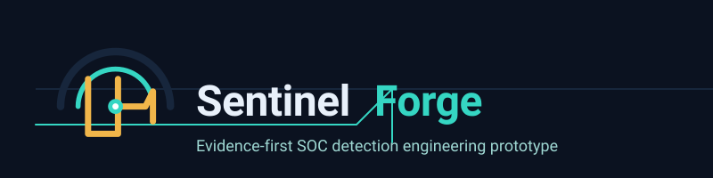
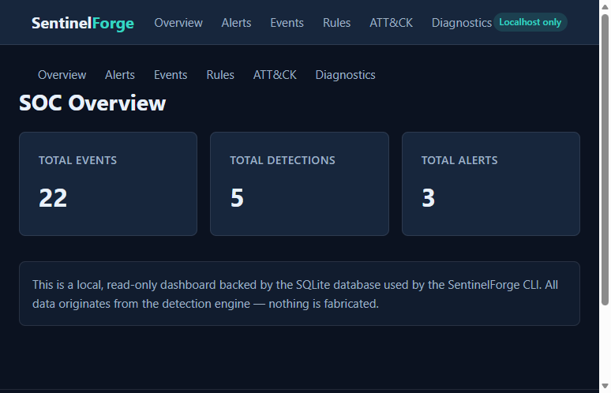
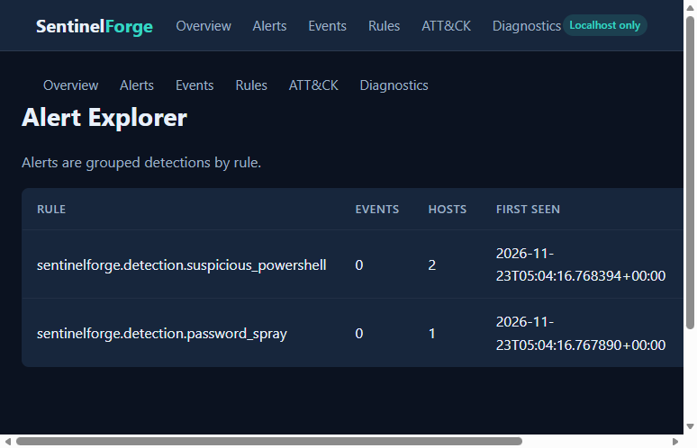
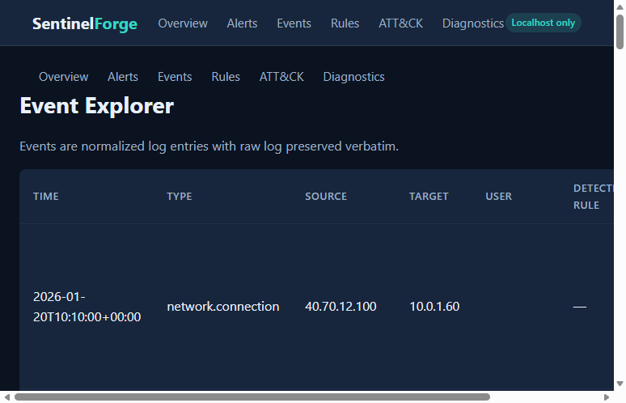
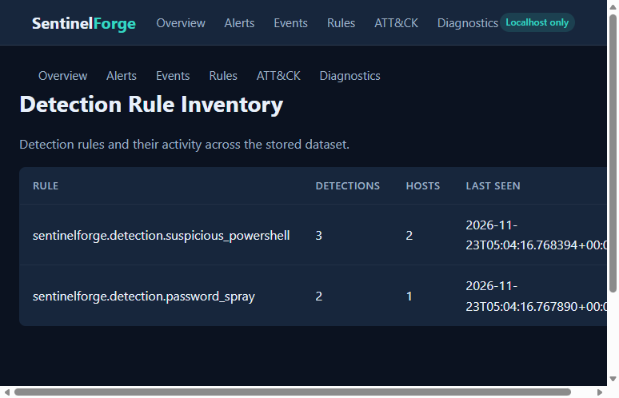
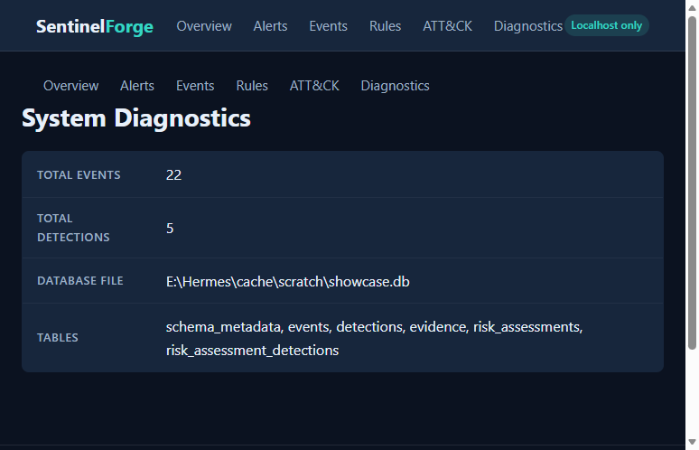

# SentinelForge

**Evidence-first Python SOC detection engineering prototype with normalized log ingestion, explainable detections, ATT&CK context, SQLite evidence storage, and synthetic security datasets.**

**Version:** 0.1.0 (prototype)
**Classification:** Demonstrable SOC prototype — not production-ready
**License:** MIT
**Python:** >=3.11
**Tests:** 462 pass in CI on Python 3.12 and 3.13 (latest verified run, November 26, 2026)
**Live website:** https://sadashivpole.github.io/sentinelforge-ai/

## Project Status

| Area | Status |
|------|--------|
| Core detection engine | Implemented |
| Log ingestion & normalization | Implemented |
| SQLite evidence storage | Implemented |
| Synthetic dataset generation | Implemented |
| Detection evaluation | Implemented |
| Local SOC dashboard | Implemented (localhost only) |
| Public website | Deployed (GitHub Pages) |
| AI support assistant | Preview only (no backend) |
| Production deployment | Not planned |

The AI support chat widget on the public website is a **UI preview**. No backend is connected, no AI responses are generated, and no visitor messages are sent to any AI service.

## Local SOC Dashboard Screenshots

Genuine screenshots from the local dashboard (`sentinelforge dashboard`, bound to `127.0.0.1:8080`, read-only, SQLite-backed):

| View | Screenshot |
|------|------------|
| Dashboard overview |  |
| Alerts |  |
| Events |  |
| Detection rules |  |
| Diagnostics |  |

*All screenshots are unmodified captures from the local dashboard running against synthetic data. The dashboard is not exposed publicly and does not connect to the public website.*

## Key features

- **Evidence-first detection.** Every alert cites the exact raw log line(s) it was derived from. No invented indicators, no detection evidence fabricated.
- **Preserve original raw logs.** The raw payload is stored verbatim alongside the normalized event.
- **No automatic remediation.** The agent surfaces findings; humans act.
- **No execution of log content.** Command strings in logs are never executed, only inspected as text.
- **LLM calls optional.** Starts with a mock AI provider; real providers are pluggable and disabled by default.
- **No credentials in source code.** All configuration comes from environment variables or a local `config.env` (never committed).

## Architecture overview

```
sentinelforge/
├── cli/                  # CLI: ingest, detect, evaluate, dashboard
├── ingestion/            # JSON / JSONL / Sysmon readers + normalizer
├── detection/            # 5 detection rules + rule registry
├── risk/                 # Explainable risk scoring + correlator
├── storage/              # SQLite schema (v3) + repositories
├── datasets/             # Synthetic dataset generation + evaluation
├── dashboard/            # Local read-only HTTP dashboard (127.0.0.1:8080)
└── analyst/              # Optional MCP server (7 read-only tools)
```

## Detection capabilities

SentinelForge normalizes JSON, JSONL, and Sysmon-style logs into a common event schema while preserving the original raw payload. Five detection rules are implemented:

| Rule | MITRE technique | What it detects |
|------|-----------------|-----------------|
| FailedLoginBurstRule | T1110 / T1110.001 | Multiple failed authentications within a window, grouped by (source IP, username, host) |
| PasswordSprayRule | T1110.003 | Auth attempts across many usernames from a common source |
| SuspiciousPowerShellRule | T1059.001 | Encoded commands, hidden execution, bypass, download-and-execute, obfuscation |
| SuspiciousProcessTreeRule | T1204 / T1204.002 | Suspicious parent-child relationships (e.g., Office → PowerShell) |
| C2BeaconRule | T1071 | Statistical beaconing on connection intervals |

Explainable risk scoring (0–100) combines severity, evidence quality, event frequency, correlation, and optional asset criticality. Risk score, evidence confidence, and detection severity are kept separate — a score is not a probability of compromise.

## SOC Analyst MCP Integration

SentinelForge includes an optional SOC Analyst MCP integration built on MCP SDK v2 (`mcp==2.3.0`). It is **optional**: the core installation works without it, and default installation does not pull in the MCP dependency.

The MCP server exposes **seven read-only tools** over local stdio (JSON-RPC 2.0):

| Tool | Purpose |
|------|---------|
| `sentinelforge_get_status` | Database/schema status, counts, latest timestamps |
| `sentinelforge_list_alerts` | Detection alerts with pagination and filters |
| `sentinelforge_get_alert` | Single alert by detection ID, with evidence references |
| `sentinelforge_get_alert_evidence` | Evidence for an alert, bounded pagination |
| `sentinelforge_search_events` | Parameterized event search with disclosed filters |
| `sentinelforge_build_investigation_brief` | Deterministic event/alert timeline for a host or alert |
| `sentinelforge_list_risk_assessments` | Risk assessments with filters |

All tools carry MCP annotations (`readOnlyHint: true`, `destructiveHint: false`, `idempotentHint: true`, `openWorldHint: false`). Read-only enforcement is at the SQLite connection level (`mode=ro` URI plus `PRAGMA query_only=ON`), not merely a tool annotation. Queries are bounded (LIMIT capped at 500, OFFSET capped at 10,000), responses enforce a 1 MiB size budget, and evidence counts come from exact `COUNT(*)` queries — never from loading raw payloads just to count rows.

The MCP server communicates over stdio only — no network, no HTTP, no shell execution, no arbitrary SQL. It integrates with Hermes as a local SOC analyst capability (`integrations/hermes/skills/`).

**Correlation does not imply causation.** Host/time-window grouping separates same-host detections from detections within a configured correlation window. Proximity alone never establishes an attack chain.

## Dataset and evaluation summary

SentinelForge generates reproducible synthetic enterprise SOC datasets (11,298 events across 19 scenarios, seed 42) written to `data/generated/`. Ground truth labels are stored separately from raw events to prevent data leakage.

Running the generated dataset through the full pipeline (ingest → normalize → detect → correlate → risk score → SQLite) produces 172 detections and 7 risk assessments, with `PRAGMA integrity_check` returning `ok` and zero foreign-key violations.

Detection quality is evaluated against an independently authored holdout dataset (69 events, not generated by the scenario code). Alert-level and event-level metrics are computed separately — F1 is reported only when the unit and population match. These are synthetic evaluation results, not real-world production performance.

## Security model and important limitations

- SQLite does not provide encryption — restrict database file access at the OS level.
- Real security logs may contain sensitive information (PII, credentials, IP addresses).
- The local dashboard binds to `127.0.0.1` only and exposes no state-changing endpoints.
- SentinelForge is a prototype, not a production SIEM or autonomous SOC.
- Real-time collection, threat-intelligence integrations, case management, and autonomous response are not implemented.
- The public demo uses synthetic, precomputed data and performs no live detection.

## Recent improvements

- SOC Analyst MCP server with seven read-only tools and Hermes integration.
- Read-only database enforcement (`mode=ro` + `PRAGMA query_only=ON`) with SQL injection regression coverage.
- Exact evidence counts and pagination for MCP evidence retrieval.
- Investigation scope validation, preventing mixed-host investigations.
- Bounded MCP responses with a 1 MiB size budget and explicit truncation metadata.
- Timezone-aware timestamp filtering and chronological ordering across mixed UTC offsets.
- Regression tests and Python 3.12/3.13 CI validation.
- Default installation and optional MCP installation verified on clean virtual environments.
- M8.1 evaluation: event-level evaluation and the confusion matrix now share category-matching logic (`alert_categories_match` / `CATEGORY_ALIASES`); wrong-category detections on suspicious evidence are counted as attribution errors, not true detections. Regenerated report is internally consistent: 641 suspicious events, 498 detected, 143 missed, 0.7769 recall.
- MCP stdio: fixed tool-call parameter-model registration so all seven read-only tools invoke correctly over stdio; SQLite read-only enforcement (`mode=ro` + `PRAGMA query_only=ON`) retained.

## Documentation, contribution, and license

- [Installation](docs/INSTALLATION.md) — step-by-step setup, configuration, quick start
- [Local Dashboard](docs/LOCAL_DASHBOARD.md) — running the localhost SOC dashboard
- [Public Demo](docs/PUBLIC_DEMO.md) — synthetic demo details and access
- [Security & Privacy](docs/SECURITY_AND_PRIVACY.md) — security model, data handling, limitations
- [CONTRIBUTING.md](CONTRIBUTING.md) — how to contribute
- [SECURITY.md](SECURITY.md) — vulnerability reporting and security policy
- [LICENSE](LICENSE) — MIT license

## Installation and quick start

```bash
git clone https://github.com/SadashivPole/sentinelforge-ai.git
cd sentinelforge-ai

# Create and activate a virtual environment
python -m venv .venv

# Windows PowerShell:
#   .venv\Scripts\Activate.ps1
# Linux/macOS:
#   source .venv/bin/activate

# Install core application (no MCP dependency)
pip install -r requirements.txt
pip install .

# Verify installation
sentinelforge --help
sentinelforge dashboard --help

# Run the test suite
python -m pytest
```

Quick workflow:

```bash
# Ingest log files (JSON, JSONL, or Sysmon-converted JSON)
sentinelforge ingest data/sample.jsonl

# Run detection rules on stored events
sentinelforge detect

# Evaluate detection quality
sentinelforge evaluate

# Start the local dashboard (localhost only, http://127.0.0.1:8080)
sentinelforge dashboard
```

### Optional MCP installation

```bash
pip install "sentinelforge[analyst-mcp]"
sentinelforge-mcp
```

The MCP server reads `SENTINELFORGE_DB_PATH` (default: `data/sentinelforge.db`) and runs over stdio.
