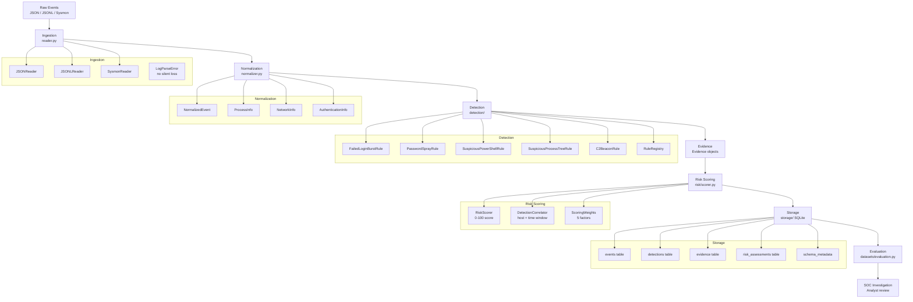
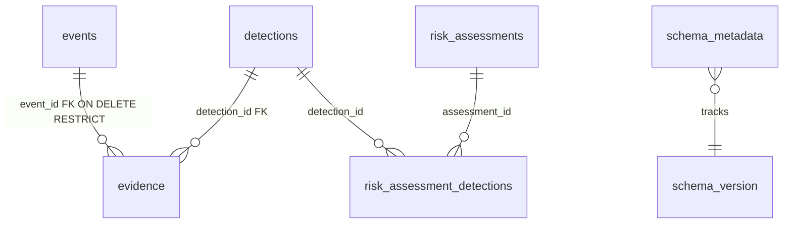
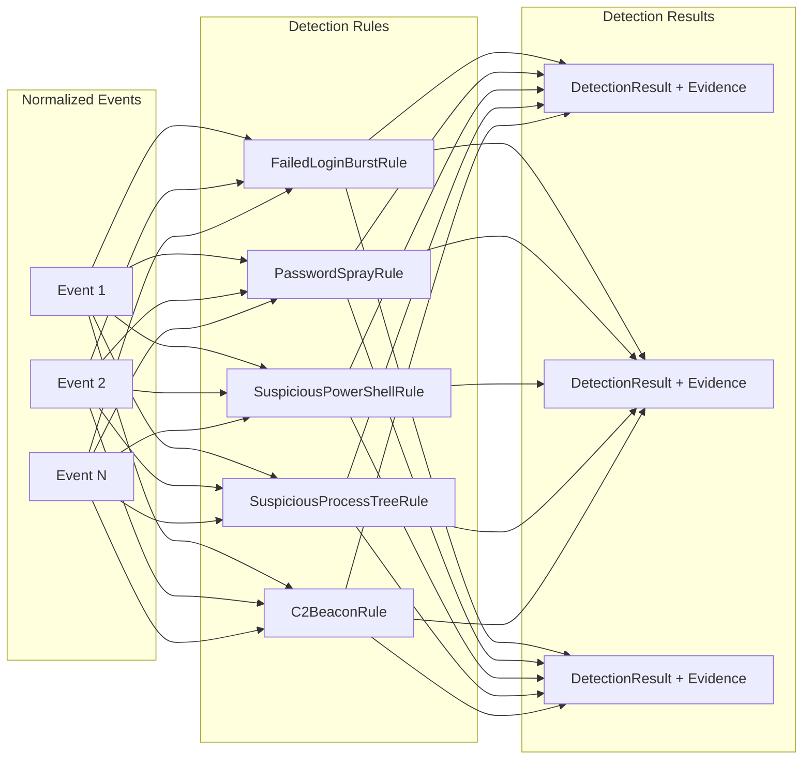

# SentinelForge AI — Architecture Documentation

**Project:** SentinelForge AI  
**Document:** `docs/SENTINELFORGE_ARCHITECTURE.md`  
**Version:** 0.1.0  
**Classification:** Demonstrable SOC Prototype

---

## 1. Overview

SentinelForge AI is a batch-oriented detection pipeline that transforms raw security logs into analyst-ready alerts with full evidence traceability. The pipeline flows through seven stages: ingestion → normalization → detection → evidence → risk scoring → storage → evaluation.

**Architecture principle:** Evidence-first. Every alert cites the exact raw log event(s) it was derived from. Raw logs are preserved verbatim and never modified during analysis.

---

## 2. Data Flow

---

## 3. Components

### 3.1 Ingestion (`sentinelforge/ingestion/reader.py`)

| Component | Responsibility |
|---|---|
| `JSONReader` | Single JSON document or list of events |
| `JSONLReader` | One JSON object per line; `LogParseError` on malformed lines |
| `SysmonReader` | Sysmon EVTX-converted JSON (Event IDs 1, 3, 11, 22); single doc or JSONL |
| `reader_for()` | Content-based reader selection (`.jsonl`, `.json`, extensionless, `.evt`, `.evtx`) |

**No silent data loss:** Malformed JSONL lines raise `LogParseError` with line number.

### 3.2 Normalization (`sentinelforge/ingestion/normalizer.py`)

| Component | Responsibility |
|---|---|
| `NormalizedEvent` | Common event schema; `raw` dict preserved verbatim |
| `ProcessInfo` | pid, ppid, name, path, command_line, user, hash_sha256 |
| `NetworkInfo` | direction, addresses, ports, protocol |
| `AuthenticationInfo` | outcome, method, username, source_address |
| `normalize()` | Maps raw dict to `NormalizedEvent` by `source` type |

**Missing fields are `null`, never fabricated.** Timestamps use best-effort ISO-8601 parsing; absent timestamps yield `None`.

### 3.3 Detection (`sentinelforge/detection/`)

| Component | Responsibility |
|---|---|
| `DetectionRule` (ABC) | Interface: `evaluate(events) → list[DetectionResult]` |
| `DetectionResult` | rule_id, rule_name, severity, evidence, metadata, unique `detection_id` |
| `Evidence` | event_id, timestamp, source, raw, plus optional fields |
| `Severity` | INFO, LOW, MEDIUM, HIGH, CRITICAL |
| `RuleRegistry` | Registers rules, evaluates all against event set |

**5 detection rules** (see Section 7). Each rule produces `DetectionResult` objects with `Evidence` citing original log events.

### 3.4 Risk Scoring (`sentinelforge/risk/`)

| Component | Responsibility |
|---|---|
| `RiskScorer` | Weighted risk score (0-100) per correlation cluster |
| `DetectionCorrelator` | Clusters detections by host + time window |
| `ScoringWeights` | 5 factors summing to 1.0 (severity, evidence quality, event frequency, correlation, asset criticality) |
| `RiskAssessment` | score, classification, factor breakdown, investigation priorities |

**Three concepts kept separate:** risk score, evidence confidence, detection severity. Asset criticality is only applied when explicitly provided.

### 3.5 Storage (`sentinelforge/storage/`)

| Component | Responsibility |
|---|---|
| `Database` | SQLite connection factory; foreign keys enabled |
| `schema.py` | Schema v3 DDL; migrations v1→v2→v3 |
| `EventRepository` | CRUD for events; duplicate-ID collision detection |
| `DetectionRepository` | CRUD for detections; immutability checks (7 fields) |
| `RiskAssessmentRepository` | CRUD for risk assessments |

**SQLite verification:** `PRAGMA integrity_check = ok`, `PRAGMA foreign_key_check = 0 violations`. All queries parameterized.

### 3.6 Evaluation (`sentinelforge/datasets/evaluation.py`)

| Model | Metric | Description |
|---|---|---|
| Alert-level | Precision | TP / assessed alerts (unassessed excluded) |
| Event-level | Recall | detected suspicious / total suspicious |

**Independent models:** No F1 cross-contamination. Attribution errors separated from false positives.

---

## 4. Database Architecture

**Tables:**

| Table | Description |
|---|---|
| `events` | Normalized events with flattened process/network/auth columns + raw JSON |
| `detections` | Detection results with metadata JSON |
| `evidence` | Evidence linked to detections; `event_id` nullable with `external_event_ref` |
| `risk_assessments` | Risk assessments with scoring factors JSON |
| `risk_assessment_detections` | Junction table linking assessments to detections |
| `schema_metadata` | Version tracking (current: v3) |

---

## 5. Interfaces

### 5.1 Configuration (`sentinelforge/config.py`)

All settings from `SENTINELFORGE_*` environment variables via `Settings` dataclass. No credentials in source code.

| Setting | Default | Description |
|---|---|---|
| `SENTINELFORGE_DB_PATH` | `data/sentinelforge.db` | SQLite database path |
| `SENTINELFORGE_AI_PROVIDER` | `mock` | AI provider (mock only) |
| `SENTINELFORGE_FAILED_LOGIN_THRESHOLD` | 5 | Burst detection threshold |
| `SENTINELFORGE_FAILED_LOGIN_WINDOW_SECONDS` | 300 | Burst detection window |
| `SENTINELFORGE_BEACON_MIN_CONNECTIONS` | 6 | C2 beacon minimum connections |
| `SENTINELFORGE_BEACON_REGULARITY_TOLERANCE` | 0.25 | C2 beacon regularity tolerance |

### 5.2 CLI

**No CLI is implemented.** The project is used as a Python library. Entry points are Python scripts (`run_pipeline_eval.py`, `validate_*.py`, `benchmark_replay.py`).

---

## 6. Detection Architecture

Each rule evaluates independently. Same event can be cited by multiple rules. Each detection cites evidence from original log events.

---

## 7. Detection Rules

| Rule | MITRE | Severity | Detects |
|---|---|---|---|
| FailedLoginBurstRule | T1110 / T1110.001 | HIGH | Failed auth bursts grouped by source/user/host |
| PasswordSprayRule | T1110.003 | HIGH | One source IP vs. multiple usernames |
| SuspiciousPowerShellRule | T1059.001 | HIGH | Encoded commands, execution policy bypass, download-and-execute, obfuscation |
| SuspiciousProcessTreeRule | T1204 / T1204.002 | MEDIUM | Office → PowerShell and similar parent-child relationships |
| C2BeaconRule | T1071 (conditional) | MEDIUM | Periodic outbound connections (potential C2, not confirmed) |

**ATT&CK mappings are candidate attributions only.** T1071 requires app-layer protocol + non-standard port + additional suspicious context. T1204.002 requires cross-event file-activity correlation.

---

## 8. Evidence Model

| Field | Type | Description |
|---|---|---|
| `event_id` | str | Original event identifier |
| `timestamp` | str | ISO-8601 UTC |
| `source` | str | Log source (json / jsonl / sysmon) |
| `event_type` | str | Event type |
| `user` | str | User associated with event |
| `host` | str | Host associated with event |
| `source_address` | str | Source IP address |
| `raw` | dict | **Original log payload, preserved verbatim** |

**Raw evidence is never modified during analysis.** Detection rules read raw evidence but do not write to it.

---

## 9. Risk Scoring Model

Five weighted factors (weights sum to 1.0):

| Factor | Weight | Description |
|---|---|---|
| Severity | 30% | Highest detection severity in cluster |
| Evidence quality | 20% | Evidence completeness (raw, timestamp, trio fields) |
| Event frequency | 20% | Number of detections in cluster |
| Correlation | 20% | Distinct detection types in cluster |
| Asset criticality | 10% | Only when explicitly provided; never invented |

Score = Σ(raw_score × weight), clamped to 0-100.

**Risk classification:** minimal (<21), low (21-40), medium (41-60), high (61-80), critical (81-100).

---

## 10. Ground Truth

Ground truth labels are stored **separately** from raw events:

| File | Content |
|---|---|
| `ground_truth.json` | Scenario-level manifest |
| `event_ground_truth.json` | Per-event labels (event_id, classification, categories, severity) |

**No labels embedded in raw events.** Events classified as `benign`, `suspicious`, or `unlabeled`. Unknown events are never silently classified as benign.

---

## 11. Known Architectural Limitations

| Limitation | Impact |
|---|---|
| Batch-only architecture | No real-time streaming, no live alerting |
| Partial Sysmon normalization | Network/DNS/file fields remain raw-only; C2BeaconRule limited |
| No authentication/authorization | No user login, RBAC, session management |
| No encryption at rest | SQLite database file unencrypted |
| No dashboard | No Streamlit or frontend UI |
| No threat intelligence | No IP/domain reputation lookup |
| CPU/memory not measured | No resource utilization instrumentation |

---

## 12. Dependencies

| Package | Purpose |
|---|---|
| Python 3.12+ | Runtime |
| pytest 8.4.2 | Test suite |
| PyYAML | Configuration (indirect) |
| sqlite3 | Database (stdlib) |

No `streamlit`, `pandas`, or external API dependencies required.

---